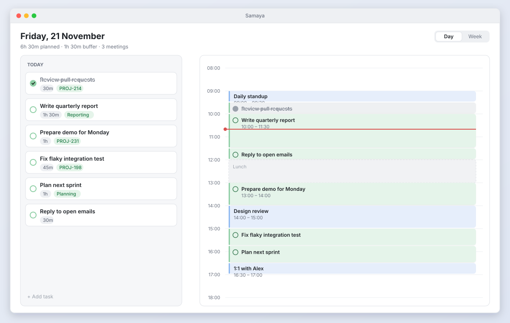
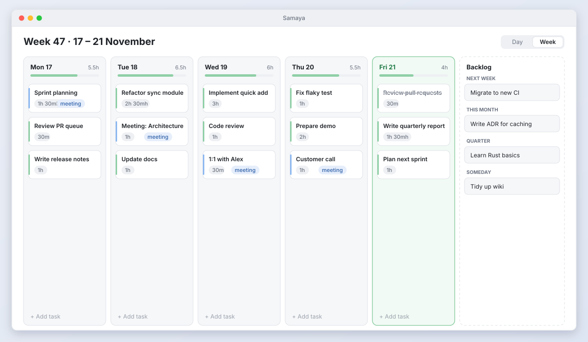
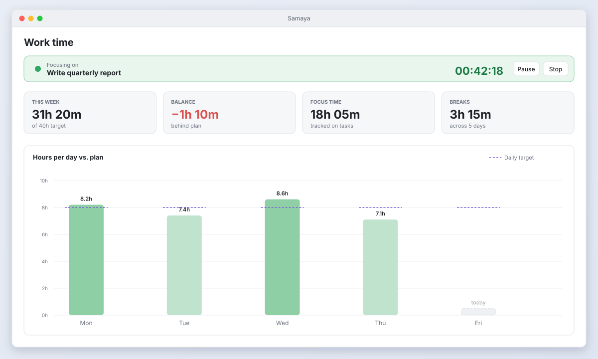
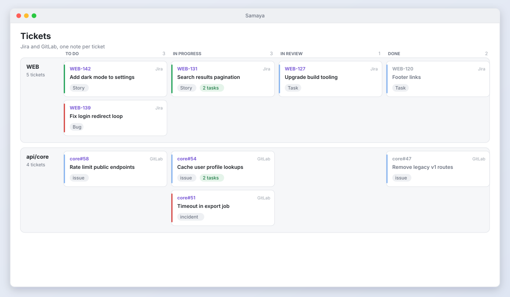

# Samaya

**A daily planner for [Obsidian](https://obsidian.md): plan your day, timebox it, focus, and track your work time. Every task, meeting and ticket stays a plain Markdown note in your vault.**

[](https://github.com/scimone/samaya/releases)
[](https://github.com/scimone/samaya/actions)




> The images in this README are illustrations drawn from the plugin's layout, with made-up data. They are not screenshots of a real vault.

## Why Samaya

Most planners keep your tasks in their own database. Samaya keeps them in your vault: a task is a note with frontmatter (`status`, `planned_sessions`, `duration_estimate`, `duration_actual`, `assigned_ticket`, `assigned_project`, `day_completed`, ...). Search, Bases, links, backlinks and sync all keep working, and you can stop using the plugin without losing anything.

## Features

### Plan the day on a timeline

The **Day** view puts the task list next to a timeline. Drag a task onto it to timebox it; meetings from your calendar are already there. Tasks can be split into parts over several days, and unplanned work waits in the backlog (next week, month, quarter, year, someday).

### See the whole week

The **Week** view is a board of days with a load bar per day, so you can see an overloaded Wednesday before it happens. An expanded week timeline is one toggle away.



### Guided planning rituals

- **Plan my day**: Review (overdue tasks), Pick, Timebox, Check.
- **Plan my week**: adds Tickets, Backlog and Schedule steps.
- **End my day**: ticks off forgotten tasks and shows a day review (plan vs. reality).

Each guide keeps a buffer reminder so you do not plan 100% of your time.

### Focus timer and work-time tracking

Start a focus on a task: the tracked time is written to the task note (`duration_actual`, `focus_sessions`) and shown on cards and in a banner. Start and end the workday, take breaks, set per-day start/finish lines and lunch, and a dashboard shows your balance against your weekly hours. Extra time outside the workday (evenings, weekends) can be logged too.



### Quick add

Bind **Samaya: New task** to a hotkey and describe a task in one line:

```
Write report 1h30m @fri #website &PROJ-123 /standup
```



| Sign | Meaning | Examples |
| --- | --- | --- |
| `@` | Day or backlog | `@today` `@tomorrow` `@mon`..`@sun` `@2026-11-20` `@+3` `@week` `@nextweek` `@month` `@quarter` `@year` `@someday` `@never` (default: today) |
| `#` | Project | `#website` (loose name match, `-` = space) |
| `&` | Ticket | `&PROJ-123` |
| `/` | Meeting | `/standup` |
| `1h30m` | Estimate | at the end of the line |

Typing a sign shows completions (↑/↓; Enter completes, the next Enter creates) and a card preview shows what will be created. Directives can stand anywhere in the line; write `\#5` to keep one in the title. Each sign may appear once, and picking a completion replaces an existing word with the same sign. The "+ Add task" boxes in the planner, the week board and the Tasks page take the same line with their place already typed in, and so do "New task" on a ticket or project.

### Jira and GitLab tickets as notes

Every open ticket becomes a note, grouped by project on a Kanban board. Tasks link to tickets and projects, and a projects Gantt chart shows the bigger picture. See [Jira / GitLab tickets](#jira--gitlab-tickets) for the setup.



### Meetings and journal

- **Meetings.** Calendar events are notes in a folder. The planner shows them on the timeline, a banner counts down to the next one, and a Meetings page groups recurring meetings into series.
- **Journal.** Daily, weekly, monthly, quarterly and yearly notes (your core Daily notes or Periodic Notes settings, or Samaya's own) get a navigation bar, and the guides can write sections into them: planned tasks, meetings, finished tasks, a productivity review, work times and breaks.

## Install

**With BRAT:** add `scimone/samaya` as a beta plugin.

**Manually:** download `main.js`, `manifest.json` and `styles.css` from the [latest release](https://github.com/scimone/samaya/releases) and copy them into `<vault>/.obsidian/plugins/samaya/`, then enable **Samaya** under Settings → Community plugins.

Open it with the **Open Samaya** command or the ribbon icon. Requires Obsidian 1.10 or newer; works on desktop and mobile.

## Commands

Plan my day / week (guided), Start shutdown ritual, Review my week, Toggle week timeline, Start workday now, Start / End break, Open work time dashboard, New task, Focus on current note's task, Convert checkbox line to task note, Assign current task note to a ticket / project, New project, Open ticket board / journal / projects, Create Samaya files.

## Jira / GitLab tickets

Configure Jira and/or GitLab in the plugin settings, then run **Sync Jira and GitLab tickets**. Every open ticket becomes a note; tickets that disappear from the results (resolved, reassigned) are marked `closed`.

<details>
<summary><strong>Ticket variables, settings and properties</strong></summary>

### Ticket variables

Three settings can use ticket variables, always written in double braces, e.g. `{{TICKET_ID}}`:

| Variable | Value |
| --- | --- |
| `{{TICKET_ID}}` | Ticket key, e.g. `OPS-12` (Jira) or `proj#12` (GitLab) |
| `{{TICKET_TITLE}}` | Summary / title |
| `{{TICKET_TYPE}}` | Issue type, e.g. `Bug`, `Story` (GitLab: `issue`, `incident`, ...) |
| `{{TICKET_STATUS}}` | Jira status name, or GitLab state (`opened`) |
| `{{TICKET_ASSIGNEE}}` | Assignee display name(s), comma-separated |
| `{{TICKET_URL}}` | Link to the ticket |
| `{{TICKET_DESCRIPTION}}` | Description as plain text (Jira) or Markdown (GitLab) |
| `{{TICKET_PROJECT}}` | Jira project key, or GitLab `group/project` |
| `{{TICKET_SOURCE}}` | Where the ticket comes from: `JIRA` or `GITLAB` |

One extra variable is available: `{{TICKET_TITLE_SLUG}}` (the title as a lowercase slug, max 60 characters). Unknown variables are left as they are. Older `{{TASK_*}}` names still work in templates.

| Setting | Variables allowed | Default |
| --- | --- | --- |
| **Tickets path** | all (in practice `TICKET_SOURCE`, `TICKET_STATUS`, `TICKET_PROJECT`, `TICKET_TYPE`, `TICKET_ASSIGNEE`) | `[Tickets]/{{TICKET_SOURCE}}/{{TICKET_STATUS}}` |
| **Ticket file name** | all | `{{TICKET_ID}}_{{TICKET_TITLE_SLUG}}` |
| **Ticket note template** | all, plus `{{date}}` and `{{date:FORMAT}}` | `# {{TICKET_TITLE}}` and a link to the ticket |

- **Tickets path** is a folder pattern. Date parts use [moment.js format](https://momentjs.com/docs/#/displaying/format); literal text goes in `[brackets]`. Example: the default `[Tickets]/{{TICKET_SOURCE}}/{{TICKET_STATUS}}` puts a Jira ticket with status "In Progress" in `Tickets/JIRA/In Progress/`. Values are made safe for folder names (an empty value becomes `None`). If the path contains `{{TICKET_STATUS}}`, a note moves to the new folder when the ticket's status changes.
- **Ticket file name** has no `.md`; characters not allowed in file names are replaced. If a name is taken, ` 2`, ` 3`, ... is appended.
- **Ticket note template** is the path of a template note in your vault, e.g. `Templates/Ticket`. Empty uses the built-in template. The template is only used when a note is created; later syncs update properties, not the body.

### Ticket properties

Sync writes these properties to each ticket note (overwritten on every sync):

| Property | Value |
| --- | --- |
| `source` | `jira` or `gitlab` |
| `id` | `TICKET_ID` (also stored in `aliases`, so `[[OPS-12]]` links resolve) |
| `title` | `TICKET_TITLE` |
| `project` | `TICKET_PROJECT` |
| `status` | `TICKET_STATUS` (`closed` once the ticket no longer appears in sync) |
| `type` | `TICKET_TYPE` |
| `assignee` | `TICKET_ASSIGNEE` |
| `url` | `TICKET_URL`; sync matches existing notes by this, so don't edit it |
| `aliases` | `[TICKET_ID]` |

Notes created by version 0.1.3 or earlier (`key`, `summary`, `state`, `issue_type`, `type: ticket`) are migrated on the next sync.

</details>

## Development

Written in TypeScript and bundled with esbuild.

```
npm ci
npm run dev     # watch build
npm run build   # typecheck + production bundle (main.js)
npm test        # typecheck + unit tests (test/run.mjs)
```

Releases are built by GitHub Actions when a tag equal to the `manifest.json` version is pushed; the workflow attaches `main.js`, `manifest.json` and `styles.css` to a GitHub Release.
